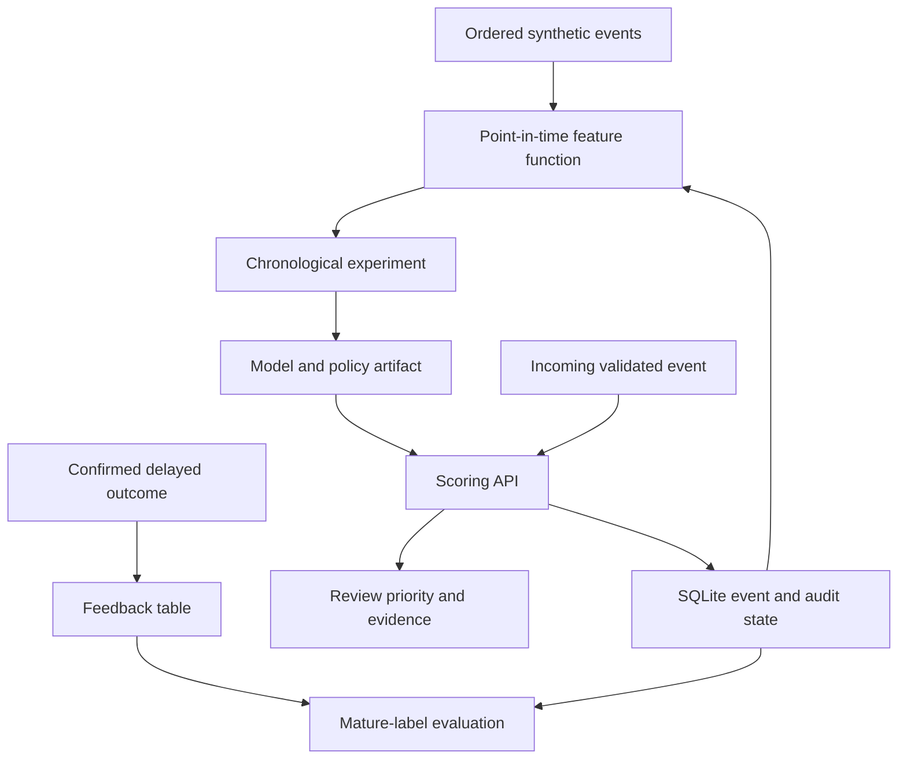

# System design

## Implemented data flow

The offline feature builder and online API call the same `extract` function. Offline history uses bounded deques. Online history uses indexed SQLite queries. Both exclude the current event and any event with the same timestamp. The API serializes each read-score-write operation inside `BEGIN IMMEDIATE` and persists the response for idempotent retries.

## Contracts and invariants

1. Events arrive in nondecreasing global event time. Older arrivals receive 409. This is intentionally stricter than a production stream with watermarks and partitioned ordering.
2. Identical transaction IDs and payloads return the original decision, including its original model version. Changed payloads under an existing ID are conflicts.
3. Unknown raw input fields, including labels, are rejected. The model's feature list must match exactly.
4. A score failure or state-write failure commits neither new history nor a decision. Database contention is surfaced as 503 with retry using the same transaction ID.
5. Historical features contain no outcome labels. The two-day label assumption affects supervised fitting and monitoring, not the availability of prior event activity.
6. Only trusted, integrity-checked synthetic-schema artifacts can be loaded by the reference event API. IEEE-CIS uses a separate model schema.

## Deliberate design choices

**Small, inspectable stack.** Pandas and scikit-learn keep the experiment approachable on a CPU laptop. FastAPI makes the contract visible. SQLite makes atomicity and persistence observable without cloud costs. This release does not use Kafka, Redis, a graph database, a feature store service, MLflow, Kubernetes, or a warehouse. Their names are not substitutes for working behavior.

**Graph signals and learned messages.** The original service uses `device_accounts_24h`, a rolling degree feature. Version 1.1 also trains offline relational GNN candidates with strictly earlier account/device neighbor messages. See GNN_RESEARCH_DESIGN.md. The service still uses the tabular artifact. A graph state service, warm-up path and promotion contract remain outstanding.

**Model choice is empirical.** Logistic regression wins seed 42 on validation cost, while gradient boosting wins the other two seeds. Anomaly detection remains visible as a challenger. Complexity is not a criterion for selection.

**Evidence brief.** Rules quote observed feature values and a fixed policy checklist. These rules do not explain exactly why the estimator scored an event. Separately, reference sensitivity reports the change when a single feature is replaced by its training reference. It is neither causal nor additive, and correlated features can make it misleading. Global permutation importance is computed on validation data.

## Suggested later architecture

For a genuine payment environment, replace the reference state store with a durable, partitioned event log and a feature service supporting watermarks, late arrivals, retention and consistent online/offline snapshots. Introduce identity-aware gateway controls, signed model promotion, shadow evaluation, capacity enforcement, separate analyst case management, and centrally collected telemetry. The migration document distinguishes these future systems from shipped code.

